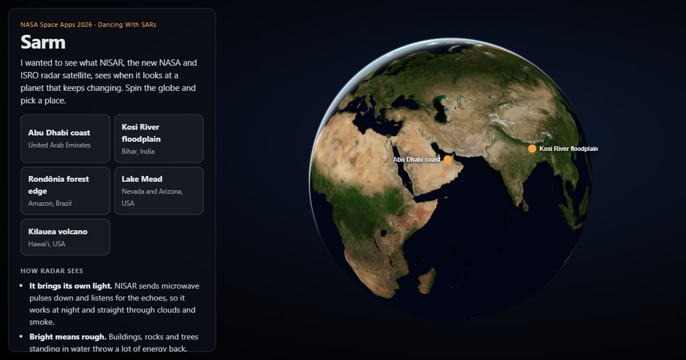

# Sarm

We built Sarm for NASA Space Apps 2026, for the **Dancing With SARs** challenge. It's an open-source web app that uses NISAR's L-band radar to watch the ground change.

Live: https://yaasshh09.github.io/sarm/



There are three ways in:

- **Globe**: a spinning NASA Blue Marble Earth. Fly down to a site, or take the tour of all five, and the newest NISAR pass is draped over it.
- **Explore**: real NISAR GCOV backscatter over each site. You can swipe between dates, map what changed, chart any pixel over time, or hit "Try this" for a guided first look. Links like `#explore/kosi/story` open straight into that guided view.
- **Rewind**: Sentinel-1 C-band (2015 on) and Landsat photos (1985 on) for the longer story. We always label them as other sensors. There's also a then-vs-now photo comparison, and links like `#rewind/lake-mead/then` open straight into it.

We picked five places where the ground is clearly changing: the Abu Dhabi coast (land reclamation), the Kosi River in Bihar (monsoon floods), the Rondônia forest edge in Brazil (deforestation), Lake Mead (drought) and Kīlauea in Hawaiʻi (lava flows).

The data is NISAR L2 GCOV from the ASF DAAC, plus Sentinel-1 RTC and Landsat Collection 2 Level-2 from Microsoft Planetary Computer. Our build plan is in [PLAN.md](PLAN.md), and the coverage checks behind the site choice are in [pipeline/coverage_report.md](pipeline/coverage_report.md).

## Develop

```
cd web && npm install && npm run dev
python -m venv pipeline/.venv && pipeline/.venv/Scripts/pip install -r pipeline/requirements.txt
python pipeline/coverage.py
```

Put your Earthdata token in the `EARTHDATA_TOKEN` env var, and never commit it.

License: MIT. See also our [terms](https://yaasshh09.github.io/sarm/#terms) and [privacy policy](https://yaasshh09.github.io/sarm/#privacy).
